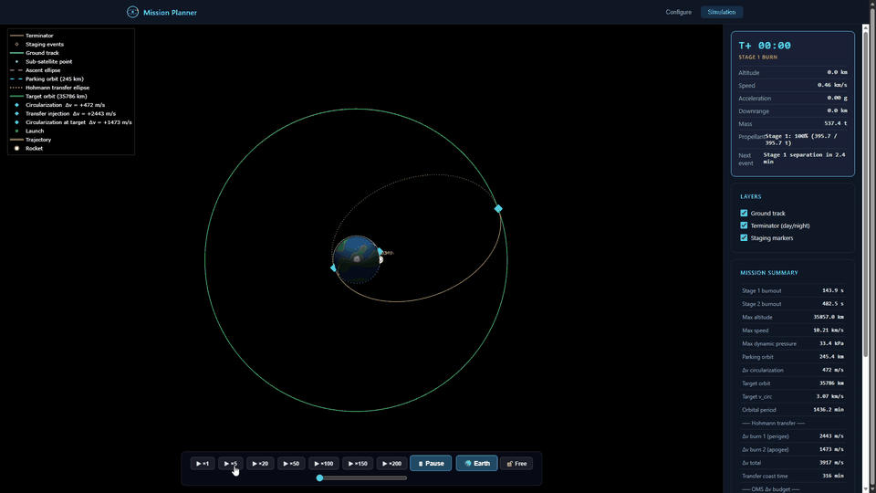

# 🚀 Orbital Mission Planner

[](https://github.com/Nava-19/orbital-mission-planner/actions/workflows/tests.yml)

A Python-based orbital mission and rocket launch simulator built around a custom orbital mechanics and atmospheric flight physics engine, with an interactive 3D web interface using Flask and Plotly.

The project explores multi-stage rocket ascent, closed-loop guidance, orbital insertion, orbital transfers, Earth-Moon trajectories and atmospheric reentry through numerical integration and physical modelling.

> 🚧 **Work in Progress**
>
> This is an ongoing personal engineering project. The simulator is still under development, and its models have not yet undergone a complete independent validation campaign. It is intended as an educational and engineering portfolio project, not as an operational mission-planning tool.

## 🎬 Demo

### LEO-to-GEO Orbital Transfer



The demonstration shows an orbital transfer from a parking orbit to GEO, including the transfer trajectory and final orbit.

## ✨ Main Features

### Ascent & Guidance

- **2D physics engine:** numerical integration using `scipy.solve_ivp`, modelling gravity, thrust, atmospheric drag and Earth's rotation.
- **Multi-stage vehicles:** configurable stage count, propellant type, thrust, specific impulse and aerodynamic parameters.
- **Rocket presets:** Falcon 9, Falcon Heavy, Ariane 5 ECA and Saturn V, alongside fully custom vehicles.
- **Closed-loop PEG guidance:** a simplified Powered Explicit Guidance algorithm that repeatedly resolves the steering law from the vehicle's current state using numerical shooting (`scipy.optimize.least_squares`), rather than following a fixed pitch program.

### Orbital Operations

- Direct orbital insertion or automatic Hohmann transfer to a higher target orbit.
- Target orbit presets including LEO, SSO, MEO and GEO, with custom altitude options.
- **Shared OMS Δv budget:** circularization, Hohmann transfers, optional orbital maneuvers and lunar mission burns draw from a common user-configurable propulsion budget for the payload/upper stage.
- Optional orbit-raising and orbit-lowering maneuvers after insertion.

### Lunar Missions

- **Earth-Moon gravitational model:** the Moon is represented as a second gravitational body following a simplified circular, coplanar orbit. Its gravity is included in spacecraft propagation.
- **Phase-synchronized lunar arrival:** the Moon's orbital phase is solved to align its position with the spacecraft's planned arrival.
- **Trans-Lunar Injection (TLI):** transfer from Earth orbit towards the Moon.
- **Lunar Orbit Insertion (LOI):** vector-based capture maneuver to establish a bound lunar orbit.
- **Trans-Earth Injection (TEI):** optional return trajectory, using numerical targeting of atmospheric entry conditions.

### Atmospheric Reentry

- Multi-burn deorbit sequence from a high parking orbit.
- Ballistic descent with atmospheric drag.
- Atmospheric impact detection.

### Atmosphere Model

- ISA polytropic atmosphere model for the troposphere and lower stratosphere (0–20 km).
- PCHIP-smoothed interpolation of the reference exponential atmosphere table from 20 km to 1,000 km.
- Atmospheric density matches the reference table at its published altitude nodes, based on Vallado's *Fundamentals of Astrodynamics and Applications*.

### Visualization & Reporting

- Interactive 3D trajectory visualization using Plotly.
- Ground track and day/night terminator.
- Staging events and prograde/retrograde Δv maneuver markers.
- Selectable Earth-centered, Moon-centered and free camera views.
- Adjustable playback speed (×1 to ×200) and trajectory scrubbing.
- One-click PDF mission report generated client-side using `jsPDF` and `Plotly.toImage`, including trajectory visualization, mission summary, orbital elements and burn sequence.

## 🧪 Validation Against Reference Data

The simulator includes engineering checks against analytical results and published reference data. These checks help assess the physical plausibility of the models, but do not replace independent validation against a high-fidelity mission analysis tool.

| Quantity | Simulator result | Reference |
|---|---:|---:|
| Atmospheric density at reference table nodes (20–1,000 km) | Exact match | Vallado exponential atmosphere table |
| Falcon 9 ascent maximum dynamic pressure | ≈ 33 kPa | Approximately 30–40 kPa for real Falcon 9 flights |
| Trans-Lunar Injection Δv (LEO to Moon distance) | ≈ 3.08 km/s | Approximately 3.1–3.2 km/s |
| Lunar Orbit Insertion Δv | ≈ 0.7–1.0 km/s, depending on orbit size | Approximately 1.0 km/s for Apollo LOI burns |
| Reentry flight path angle at 122 km entry interface | ≈ −6° to −8° | Approximately −6.5° Apollo entry corridor |

These results emerge from the implemented physical models and numerical calculations. They are useful reference checks, not proof of complete physical fidelity.

Additional automated tests cover orbital elements, Hohmann transfers, energy and angular momentum conservation, atmospheric modelling and reentry impact detection.

**Independent trajectory comparison with NASA GMAT remains planned work.** The reference checks above should not be interpreted as completed GMAT validation.

## 🏗️ Project Structure

```text
orbital-mission-planner/
├── .github/
│   └── workflows/       # GitHub Actions CI
├── docs/                # Demo assets and technical reference
│   └── Demo_26-11-05.gif
├── static/
│   ├── main.js          # Frontend, Plotly visualization and PDF report
│   └── style.css
├── templates/           # Flask/Jinja templates
├── tests/               # Automated test suite
├── app.py               # Flask application and mission orchestration
├── vehicle.py           # Rocket/stage models and PEG guidance
├── solver.py            # Equations of motion and numerical integration
├── orbital.py           # Orbital mechanics and transfer calculations
├── environment.py       # Atmospheric density and gravity models
├── constants.py         # Physical constants
├── requirements.txt
├── requirements-dev.txt
├── ToDoList.md           # Roadmap and implementation notes
├── LICENSE
└── README.md
```

## 📚 Technical Documentation

The technical reference documents the equations, reference frames, unit conventions, numerical integration methods and modelling assumptions used throughout the simulator.

- [Technical Reference](docs/TECHNICAL_REFERENCE.md)
- [Development Roadmap and ToDo List](ToDoList.md)

## ⚠️ Current Limitations

The simulator deliberately uses simplified models in several areas. These assumptions define the current scope of the project:

- **2D dynamics:** the physics engine operates in a single orbital plane. It does not model arbitrary orbital inclinations or fully three-dimensional spacecraft dynamics.
- **Simplified lunar ephemeris:** the Moon follows a circular, coplanar orbit with an arbitrary initial phase, rather than a real ephemeris.
- **Impulsive maneuvers:** orbital burns are modelled as instantaneous velocity changes, not finite-duration engine burns.
- **Ballistic reentry:** the reentry model includes atmospheric drag but does not model aerodynamic lift, thermal protection or parachute dynamics.
- **Aerodynamic coefficients:** drag coefficient (`Cd`) and reference area are user-supplied inputs, not computed from vehicle geometry.

These simplifications are documented in the [Technical Reference](docs/TECHNICAL_REFERENCE.md) and [ToDoList](ToDoList.md).

## 🛠️ Technology Stack

- **Python:** NumPy, SciPy, Flask
- **Numerical methods:** ODE integration and nonlinear least-squares optimization
- **Visualization:** Plotly.js
- **Frontend:** JavaScript, HTML and CSS
- **Reporting:** jsPDF
- **Testing:** pytest and GitHub Actions

## 🗺️ Roadmap

Planned improvements include:

- Independent trajectory validation using NASA GMAT.
- Higher-fidelity orbital perturbation models, including J2.
- More realistic lunar ephemerides.
- Mission configuration save/load functionality.
- Ground-station visibility analysis.
- A companion CFD workflow using SU2/OpenFOAM to estimate aerodynamic coefficients from vehicle geometries.

See [ToDoList.md](ToDoList.md) for the detailed roadmap and implementation notes.

## 📄 License

MIT License. See [LICENSE](LICENSE).

---

**Developed as a personal aerospace engineering project**, focused on orbital mechanics, flight dynamics, numerical simulation and mission analysis.
